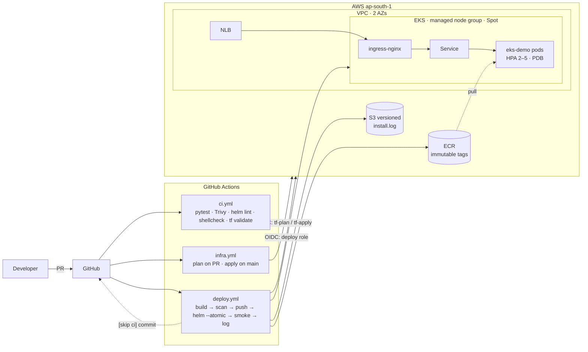

# Architecture

## Design decisions

| Decision | Why |
|---|---|
| GitHub OIDC, three roles | No static keys. Each role's trust policy is pinned to one `sub` (PR, `infra` env, `prod` env). |
| `tf-apply` gated by environment | Admin rights exist only behind a required-reviewer approval. |
| Explicit EKS access entries | `enable_cluster_creator_admin_permissions = false` so a CI apply never swaps out the human admin. |
| Immutable ECR tags `sha-<7>` | A tag always maps to one image; rollbacks are deterministic. |
| Trivy before push | Vulnerable images never reach the registry. |
| `helm --atomic --wait` | Failed rollout = automatic rollback to the last good revision. |
| Smoke test checks served version | Proves the *new* pods are serving, not just that something answers. |
| install.log in versioned S3 + repo | S3 is the tamper-evident source of truth; repo copy gives readable history in Git. |
| `concurrency: deploy-prod` | One deploy at a time, so log appends are ordered. |
| Single NAT, Spot nodes | Keeps the demo cheap; switch per README for prod. |
